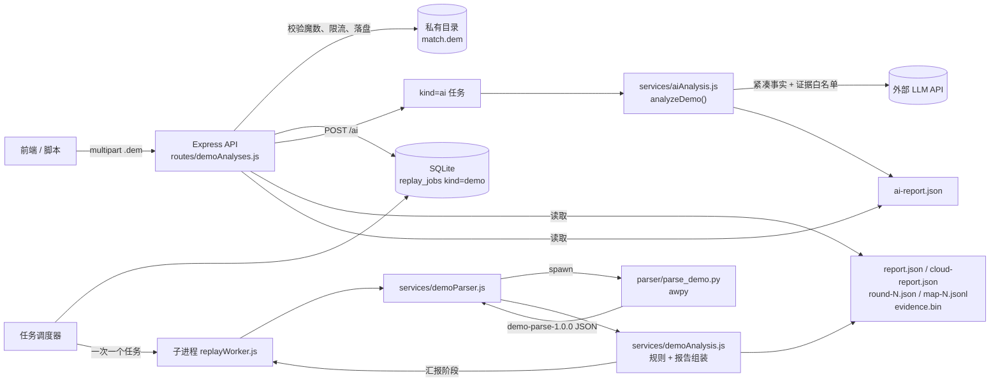

# Demo 文件 AI 分析：后端设计、实现与接口

更新日期：2026-10-28。本文描述把「上传的 CS2 `.dem` 文件」读成结构化事实、再由规则与大模型生成教练解读的后端实现。

现有 ZIP 复盘管线（[replay-analysis-design.md](replay-analysis-design.md)）假设解析发生在用户本机，云端只接收五文件 ZIP。本文补齐另一条链路：**云端直接接收原始 Demo 文件并解析**，因此不再依赖用户先跑本地解析工具。

## 1. 目标与边界

目标：

- 用户只上传一个 `.dem`，服务端能读出真实比赛数据（回合、击杀、伤害、道具、经济、位置采样）。
- 规则层产出的报告可独立阅读，不依赖大模型。
- AI 教练解读只能引用这次 Demo 里真实存在的证据 ID，不能编造。
- 失败可诊断：解析器缺失、Demo 损坏、超时、模型未配置都有明确状态码。

不做（与 ZIP 管线一致的边界）：

- 不做账号与 Steam 所有权绑定；`target_player_id` 由调用方指定或自动选全场击杀最多者。
- 不做客户端画面、语音、可见性、预瞄质量评估。
- 服务端不运行大模型；只调用 OpenAI 兼容的托管 API。
- 不支持 CS:GO（Source 1，`HL2DEMO`）与 gzip 压缩包，会返回明确错误。

## 2. 总体架构



职责划分：

| 位置 | 职责 | 不做什么 |
| --- | --- | --- |
| `parser/parse_demo.py` | 唯一懂 Source 2 格式的组件；用 awpy 抽取事实并写成 JSON | 不做规则判断、不打分、不调用模型 |
| `services/demoParser.js` | 解释器探测、子进程调用、超时与体积限制、错误映射 | 不解析 Demo |
| `services/demoAnalysis.js` | 确定性规则、模块指标、报告与产物落盘 | 不调用模型、不读原始 Demo |
| `services/aiAnalysis.js` | 组织紧凑事实、调用模型、校验输出与证据 | 不改基础报告 |
| `services/replayJobRunner.js` | 任务实际内容（import/analysis/demo/ai） | 不关心是子进程还是进程内执行 |
| `services/replayQueue.js` | 领取任务、租约、超时、完成状态写回 | 不包含业务规则 |

把「任务内容」与「如何执行」分开，是为了让同一套逻辑既能 fork 子进程（生产：崩溃隔离、内存上限），也能在禁止创建子进程的宿主上以进程内方式跑测试（`startQueue({ runner: runJob })`）。

## 3. 处理流程

1. `POST /api/v1/demo-analyses`，multipart 字段 `file`，可带 `target_player_id`。
2. 校验魔数：CS2 为 `PBDEMS2`；`HL2DEMO` 返回 400 并提示不支持 CS:GO；`1f 8b` 返回 400 提示先解压。
3. 探测解析器（`parse_demo.py --check`，结果缓存 30 秒）。不可用直接 503，不落盘。
4. 计算 `sha256(demo)`，与目标玩家一起构成去重键；同用户同 Demo 同目标玩家复用已有任务。
5. 写 `task.json`，插入 `replay_jobs(kind='demo', version='demo-1.0.0')`，返回 202。
6. 调度器领取任务，子进程执行：`parsing → analyzing → reporting`。
7. `parsing`：`parse_demo.py` 用 awpy 读取 `.dem`，输出 `parse.json`（1.4 MB 左右/10 回合）。
8. `analyzing`：`demoAnalysis.normalize()` 生成模块指标、规则命中、关键回合、证据集。
9. `reporting`：写 `report.json`、`cloud-report.json`、`round-N.json`、`map-N.jsonl`、`evidence.bin`、`report-meta.json`。
10. 调度器把摘要写回 `replay_jobs.meta`，状态转 `ready`；若开启 `AI_AUTO_ANALYZE`，再入队 `kind='ai'`。
11. 前端轮询 `GET /demo-analyses/{id}`，`status=completed` 后读取报告；AI 通过 `POST/GET /demo-analyses/{id}/ai` 触发与读取。

## 4. 解析器契约（`demo-parse-1.0.0`）

`parser/parse_demo.py` 输出单文件 JSON，关键字段：

| 字段 | 内容 |
| --- | --- |
| `schema_version` | 固定 `demo-parse-1.0.0` |
| `parser` | awpy / Python 版本与耗时 |
| `demo` | 文件名、字节数、`sha256` |
| `header` / `tick_rate` | 地图、服务器、播放时长、tick 率 |
| `players` / `stats` | 名单与 awpy 记分板（K/D/A、ADR、KAST、首杀、多杀、残局、道具） |
| `rounds` | 回合边界、胜方、结束原因、是否刀局 |
| `kills` / `damages` / `blinds` / `bomb` | 事件，均带 `event_id`、`tick`、`round_num` |
| `grenades` | 按投掷物聚合的轨迹（`points` + `point_ticks`，超长自动降采样） |
| `smokes` / `fires` | 烟雾与燃烧的时间窗、位置、投掷者（可能为 `null`） |
| `round_economy` | 每回合每阵营装备价值与 `buy_type` |
| `target_samples` | 目标玩家每 0.5 秒的位置/生命/武器/道具/经济 |
| `target_death_snapshots` | 目标玩家**每次阵亡前一个 tick**的状态 |
| `truncated` / `warnings` | 截断项与降级说明 |

实现要点（都由真实 Demo 验证过）：

- `snapshots(events="player_death")` 只返回**存活**玩家，且每个死亡 tick 都会返回全部存活者。要拿「自己死时手里有什么」，必须按自己的死亡 tick 取 `tick-1`，否则会把「别人死时我还活着」误判成死亡快照。
- 位置采样里 `velocity_x/y` 经常为 `null`，速度由相邻采样点与 tick 差推导。
- 道具轨迹的 `thrower_steamid` 在许多公开 Demo 中缺失，这类轨迹只作上下文，不计入个人道具统计。
- 所有数组都有上限（回合 60、击杀 5000、伤害 20000、轨迹点 240/条等），超限写入 `truncated`。

## 5. 规则层

`services/demoAnalysis.js` 把解析事实转成与 ZIP 管线同构的扩展报告：

| 模块 | 指标来源 | 说明 |
| --- | --- | --- |
| `basic_stats` | 击杀/伤害事件 + awpy 记分板 | K/D、ADR、KAST、爆头率、总伤害 |
| `opening_duels` | 每回合首个击杀 | 首杀/首死与胜率 |
| `utility` | `blinds` 与 `stats` | 投掷数、闪中敌人、自闪/友闪、道具伤害 |
| `death_context` | 死亡快照 | 换弹死亡、持道具死亡、携带未使用道具、未被换 |
| `economy` | `round_economy` | 装备价值与 `buy_type` 分布 |
| `movement` | `target_samples` | 采样区间水平速度、跳跃/下蹲/开镜样本数 |

规则命中（`findings`）目前包括：`death_reloading`、`death_holding_utility`、`death_unused_utility`、`untraded_death`、`self_flash`、`team_flash`、`opening_death`、`eco_loss`。每条都带 `finding_id`、`rule_id`、`round_num`、`tick`、`evidence_ids`、`observation`、`review_prompt`。

规则语义保持保守：命中表示「值得回看」，不是失误判定。没有数据支撑的模块不输出（例如本场没有残局就没有 `clutch` 模块），避免把普通比赛标成 `partial`。

## 6. HTTP 接口

基地址 `/api/v1`，全部需要 `Authorization: Bearer <token>`。响应仍是 `{code,message,data}`。

| 方法 | 路径 | 说明 |
| --- | --- | --- |
| GET | `/demo-analyses/parser` | 解析器是否可用、Python/awpy 版本、AI 是否配置、上传上限 |
| POST | `/demo-analyses` | multipart `file`（≤512 MiB），可选 `target_player_id`；202 |
| GET | `/demo-analyses` | 我的 Demo 分析列表（`page`/`pageSize`） |
| GET | `/demo-analyses/{id}` | 状态：`queued/parsing/analyzing/reporting/completed/failed` |
| GET | `/demo-analyses/{id}/report` | 标准报告（`report.schema.json`） |
| GET | `/demo-analyses/{id}/details` | 扩展报告（模块、规则、回合、走位、限制） |
| GET | `/demo-analyses/{id}/rounds/{round}` | 单回合事件与规则命中 |
| GET | `/demo-analyses/{id}/rounds/{round}/map` | 分页读取该回合点位/轨迹 JSONL |
| GET | `/demo-analyses/{id}/evidence/{event_id}` | 单条证据（击杀、伤害、闪光、死亡快照等） |
| GET | `/demo-analyses/{id}/ai` | AI 结果；未生成时返回状态、是否排队、上次错误 |
| POST | `/demo-analyses/{id}/ai` | 生成 AI 教练解读；`?force=true` 重新生成；202 |
| DELETE | `/demo-analyses/{id}` | 删除该分析及其 AI 任务 |

上传返回示例：

```json
{
  "demo_id": "4f1c…",
  "status": "queued",
  "target_player_id": null,
  "target_selection": "auto_top_fragger",
  "report_available": false,
  "ai_status": "not_configured"
}
```

`target_selection` 为 `explicit`（请求指定）或 `auto_top_fragger`（未指定时取全场击杀最多者）。目标玩家的最终值在解析完成后出现在 `target_player_id` 与报告里。

错误码：

| HTTP / code | 场景 |
| --- | --- |
| 400 / 40000 | 非 CS2 Demo、CS:GO Demo、gzip、`target_player_id` 非法、分页非法 |
| 401 / 40002 | 未登录或 token 失效 |
| 404 / 40400 | 资源不存在或不属于当前用户 |
| 409 / 40900 | 报告未就绪、容量已满、AI 正在运行 |
| 413 / 41300 | 超过 512 MiB 或解析产物过大 |
| 502 / 50200 | 模型返回非法 JSON 或引用不存在的证据 |
| 503 / 50300 | 未配置 `DEEPSEEK_API_KEY` |
| 503 / 50310 | 解析器不可用（找不到 Python/awpy） |

容量：Demo 任务全局 ≤200、单用户 ≤20，待处理全局 ≤50、单用户 ≤3。Demo、ZIP、AI 任务共用一条单并发计算队列。

## 7. AI 解读

### 7.1 输入（只给事实）

`buildDemoFacts()` 生成约 6 KB 的紧凑 JSON：

```text
kind, analysis_id,
match { map, score, rounds_played, complete, tick_rate },
target { player_id, name, team, selection, teammates },
modules { …metrics… },
rounds[≤60] { round_num, winner_side, buy{ct,t}, target{kills,deaths,damage,buy_type,equipment_value} },
findings[≤80] { finding_id, rule_id, round_num, evidence_ids, observation },
key_rounds, movement, data_quality, limitations
```

不发送地图点位、原始采样、ZIP 或 Demo 二进制；`test/aiAnalysis.test.js` 会断言事实里不出现 `points` 与 `player_samples`。

### 7.2 证据白名单

`analyzeDemo()` 允许引用的证据 ID = 报告自带的 ID（模块、规则、关键回合）∪ 传入的 `evidence-index.json` 全部键。模型若引用白名单外的 ID，返回 `50200`，不写入结果。这保证 AI 说的每一条都能在 `GET /evidence/{id}` 里查到。

### 7.3 执行方式

`POST /ai` 不直接调用模型，而是入队 `kind='ai'` 任务：模型调用发生在独立子进程，`AI_TIMEOUT_MS` 内完成；失败只让该任务失败，基础报告不受影响。开启 `AI_AUTO_ANALYZE=true` 时，Demo 报告就绪后自动入队一次。

结果保存在 Demo 私有目录的 `ai-report.json`，结构与前端 `AiCoachReport` 一致：

```json
{
  "ai_status": "completed",
  "analysis_id": "…",
  "source": { "kind": "demo_file", "match_id": "demo-…", "demo_sha256": "…", "target_player_id": "…" },
  "model": "deepseek-chat",
  "prompt_version": "coach-1.0.0-demo",
  "generated_at": "…",
  "summary": "…",
  "improvement_areas": [{ "priority": "high", "category": "utility", "title": "…", "evidence_ids": ["death_0001"], "explanation": "…", "training": ["…"] }],
  "strengths": [{ "title": "…", "evidence_ids": ["kill_0001"], "explanation": "…" }],
  "data_limitations": ["…"]
}
```

`?force=true` 会删除旧的 `ai-report.json` 与旧 AI 任务再入队，避免旧结果掩盖新失败；失败时 `GET /ai` 返回 `last_error`。

## 8. 配置

```env
# 解析器定位（可选；默认按 parser/.venv → PATH 顺序探测）
DEMO_PARSER_PYTHON=
DEMO_PARSER_SCRIPT=
DEMO_PARSER_PYTHONPATH=
DEMO_PARSER_TIMEOUT_MS=300000

# AI（与 ZIP 管线共用）
DEEPSEEK_API_KEY=
DEEPSEEK_BASE_URL=https://api.deepseek.com
DEEPSEEK_MODEL=deepseek-chat
AI_TIMEOUT_MS=60000
AI_MAX_TOKENS=2000
AI_PROMPT_VERSION=coach-1.0.0
# 报告就绪后自动生成 AI 解读（默认关闭，避免无谓计费）
AI_AUTO_ANALYZE=false
```

解析器探测顺序：`DEMO_PARSER_PYTHON` → `parser/.venv/Scripts/python.exe`（Windows）或 `parser/.venv/bin/python` → `python.exe` / `python3`。`PYTHONPATH` 默认指向 `parser/.pydeps`（若存在），便于无 root 权限的部署。

## 9. 资源与失败处理

| 项目 | 策略 |
| --- | --- |
| 上传 | ≤512 MiB，同时最多 2 个上传 |
| 解析 | 子进程，V8 512 MiB，任务预算 600 秒，租约 +30 秒 |
| 解析产物 | ≤256 MiB，超出返回 413 |
| 数据量 | 回合 60、击杀 5000、伤害 20000、证据事件数上限随回合规模 |
| AI | 独立任务，预算 180 秒，`AI_TIMEOUT_MS` 控制单次请求 |
| 重试 | 进程中断可重试至 3 次；明确的格式错误直接失败 |
| 清理 | 删除分析同时删除其 AI 任务目录；运行中的任务返回 409 |

常见故障与定位：

| 现象 | 原因 | 处理 |
| --- | --- | --- |
| `50310` | 找不到 Python 或 awpy | `pip install awpy`，或设置 `DEMO_PARSER_PYTHON` |
| 400「不是 CS2 Demo」 | 传了 CS:GO Demo/压缩包/其它文件 | 换 CS2 `.dem` 或先解压 |
| 状态停在 `parsing` 后 `failed` | Demo 损坏或超时 | 看 `message`，必要时调大 `DEMO_PARSER_TIMEOUT_MS` |
| `GET /ai` 返回 `not_configured` | 未设置 `DEEPSEEK_API_KEY` | 配置后重启 |
| `GET /ai` 带 `last_error` | 模型输出非法或引用未知证据 | 规则报告仍可用，可 `?force=true` 重试 |

## 10. 验证

```powershell
cd backend
npm test                                # 全部测试
node tests/demoAnalysis.test.js         # 规则与产物（7）
node tests/demoAnalyses.test.js         # HTTP 端到端（13）
node tests/aiAnalysis.test.js           # AI 事实与校验（6）
node scripts/analyze-demo.js match.dem data/demo-acceptance   # 真实 Demo 离线验收
```

测试覆盖：魔数与错误码（CS:GO/gzip/非 Demo）、目标玩家校验、上传→任务→报告、回合/地图分页、证据读取、AI 未配置、AI 成功、AI 引用未知证据失败、`AI_AUTO_ANALYZE` 自动入队、重复上传复用、不同目标玩家分别分析、越权与删除、解析器不可用。

本仓库当前全量 117 项测试（profile 24、lobby 14、friends 11、ZIP 复盘 42、Demo 规则 7、Demo HTTP 13、AI 6）全部通过。

**宿主限制**：部分沙箱禁止创建子进程（Node `spawn`/`fork` 返回 `EPERM`）。此时用
`REPLAY_QUEUE_INLINE=1` 或 `startQueue({ runner: runJob })` 让任务在进程内执行，测试依旧有效；
仅「fork 子进程」这一层需要在真实服务器上确认。测试中的解析器是打桩的，真实的
`parse_demo.py` 通过 CLI 单独验证。

真实数据验收（一次性，不入库）：`de_mirage`、10 回合、T 8:2 CT、目标玩家 11/5、ADR 120.7、KAST 90，6 个模块全部 `completed`，7 条规则命中，667 条证据事件，25 个产物文件；解析耗时约 2.0 秒。把该解析结果灌入 HTTP 链路再验证一次：上传 202 → `completed`、`/report` 为 `completed`、第 3 回合 89 条事件、地图分页 20 条、`/evidence/kill_0001` 命中、未知证据 404、AI `202 → completed` 且引用了真实证据 `blind_0028`，模型输入 8 KB。

## 11. 与 ZIP 管线的差异

| 维度 | ZIP 管线 | Demo 文件管线 |
| --- | --- | --- |
| 输入 | 五文件 ZIP（schema 1.1/1.2） | 原始 `.dem` |
| 解析位置 | 用户本机 | 服务端 awpy 子进程 |
| 报告契约 | `report-1.0.0` | 同左，`source.kind=demo_file` |
| 证据 | 包内事件 | 解析得到的事件（`kill_*`/`hurt_*`/`blind_*`/`death_*`） |
| 地图数据 | 包内 0.5 秒采样与轨迹 | 目标玩家 0.5 秒采样 + 手雷轨迹 |
| 目标玩家 | manifest 固定 | 请求指定，缺省取全场击杀最多者 |

两者共用任务表、私有目录、单并发队列、AI 服务与响应封装，但路由与存储命名空间独立，互不影响。

## 12. 后续扩展

- 多目标玩家：一次解析产出全场事实，按玩家分别生成报告（当前同一 Demo 换目标会重新解析）。
- 训练建议入库：把 AI 的 `training` 转成可追踪的训练任务。
- 地图控制与进攻路线：基于全员采样（awpy `snapshots` 全玩家）计算区域控制率，目前只保留目标玩家采样以控制体积。
- 结果缓存：同一 `sha256 + 目标玩家` 的规则结果已通过任务复用；AI 结果可按 prompt 版本缓存。
