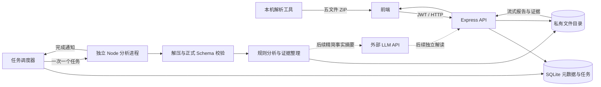

# Demo 复盘分析：架构、实现与接口说明

更新日期：2026-10-24。本文以当前代码和 `analysis-handoff` 交接协议为依据。

已接入 GLOBAL-EXPORT-v1.2 全员导出。全员接口、完整轨迹校验及分页契约见 [v1.2 接入说明](../backend/REPLAY_V12.md)。单人分析和 AI 解读设计继续沿用本文。

**已实现：本地解析包的云端导入、规则分析、报告、证据、历史与资源删除；GLOBAL-EXPORT-v1.2 全员导出；可选 AI 教练解读（`GET/POST /analyses/{analysis_id}/ai`，同步调用、JSON Schema 与 evidence_ids 校验、未配置时返回 50300）。未实现：独立 AI 队列、缓存、评论任务表和前端 AI 卡片。第 8 节同时说明当前基础实现和后续异步扩展。**

## 1. 功能范围与数据来源

本机解析工具处理原始 `.dem`，由用户确认名单中的目标 SteamID 后导出 ZIP。云端接收 ZIP，不再次运行 awpy，也不接收原始 Demo 来完成解析。

```text
分析包.zip
├── manifest.json  身份、版本、玩家名单、文件大小与摘要、数据质量
├── metrics.json   本地已计算的模块和按回合/武器统计
├── rounds.json    回合边界、阵营、经济与目标玩家状态
├── events.json    击杀、伤害、开火、闪光、死亡状态等事件
└── map.json       周期状态、交火关键帧、关联玩家和道具轨迹
```

上传协议支持 `schema_version=1.1.0 / 1.2.0`，标准报告为 `report_schema_version=1.0.0`。这两个版本分别管理，不能混为同一个版本号。v1.2 新增全员字段，原有目标玩家字段保持独立。

协议原件位于 [contracts](../backend/contracts/)：

- [package-v1.1.schema.json](../backend/contracts/package-v1.1.schema.json)：上传数据校验规则。
- [package-v1.2.schema.json](../backend/contracts/package-v1.2.schema.json)：全员导出校验规则。
- [report.schema.json](../backend/contracts/report.schema.json)：标准报告结构。
- [openapi.json](../backend/contracts/openapi.json)：原始前端交接契约，也包含独立本机解析服务的接口。
- [frontend-contracts.ts](../backend/contracts/frontend-contracts.ts)：前端类型副本。

OpenAPI 原件保留交接时的描述；本文补充实际已实现的扩展接口和限制。`/local/*` 属于本机解析工具，不由本云端服务提供。

## 2. 总体架构



API 进程负责鉴权、文件接收、任务调度和读取结果；计算放在独立 Node 子进程。SQLite 保存任务、包索引和摘要，较大的 JSON、轨迹与原 ZIP 保存在私有磁盘目录。

上传校验与正式分析分成两个任务，但共用单并发计算队列。上传请求等待校验完成才返回 HTTP 201；此时没有执行规则分析。前端随后显式创建分析任务，得到 HTTP 202 后轮询。

### 2.1 代码职责

| 文件 | 职责 |
| --- | --- |
| [routes/analysis.js](../backend/src/routes/analysis.js) | 当前前端接口、包复用、分析幂等、历史和删除 |
| [services/replayStore.js](../backend/src/services/replayStore.js) | SQLite 表、私有目录和旧任务访问控制 |
| [services/replayQueue.js](../backend/src/services/replayQueue.js) | 抢占任务、租约恢复、子进程管理、结果状态保存 |
| [replayWorker.js](../backend/src/replayWorker.js) | 按 import / analysis / legacy 类型执行任务 |
| [services/replayImport.js](../backend/src/services/replayImport.js) | ZIP 条目检查、摘要验证、身份关联、地图流式读取 |
| [services/replaySchema.js](../backend/src/services/replaySchema.js) | 编译正式 Schema，校验文件、地图记录及报告 |
| [services/replayGlobal.js](../backend/src/services/replayGlobal.js) | 全员轨迹语义校验、JSONL 与定长偏移索引、按回合分页 |
| [services/replayAnalysis.js](../backend/src/services/replayAnalysis.js) | 确定性规则、回合筛选、状态观察、证据索引 |
| [services/cloudReplay.js](../backend/src/services/cloudReplay.js) | 导入产物、兼容证据投影、标准报告组装 |
| [routes/demos.js](../backend/src/routes/demos.js) | 旧 `/demos` 客户端兼容；不访问新协议任务 |

### 2.2 数据库和文件存储

| 表 | 主要内容与约束 |
| --- | --- |
| `replay_jobs` | 内部任务 ID、owner_id、类型、摘要、版本、状态、阶段、尝试次数、租约、错误和时间；唯一键为用户/摘要/版本 |
| `analysis_packages` | 用户、package_id、match_id、target_player_id、存储任务 ID、内容签名、上传时间、manifest；主键为用户/package_id |
| `analysis_runs` | analysis_id 对应内部任务、包和比赛标签、幂等键、请求摘要、终态和摘要；用户/幂等键唯一 |

任务类型为 `import`、`analysis`、`legacy`。内部任务状态使用 `queued/running/ready/failed`；对新前端响应时，`ready` 映射成 `completed` 或 `partial`。

默认文件目录为 `backend/data/replays/<内部任务UUID>/`，可用 `REPLAY_DIR` 配置。路径使用服务器生成的 UUID，不把客户端提供的 package_id 拼成磁盘路径。

- 导入目录：原 ZIP、校验后的五个 JSON、`validated.json`、详细事件数组、兼容事件和兼容轨迹。
- 分析目录：任务元数据、原 ZIP 副本、`cloud-report.json`、扩展 `report.json`、回合 JSON、分回合地图 JSONL、证据二进制文件和偏移索引。
- 分析完成后删除该分析目录中的临时解压 JSON；导入目录保留原始数据以支持证据读取。
- 删除分析只删除该次分析；删除包会删除它的全部分析。存在运行中的相关任务时返回 409。

账户隔离依据登录 JWT 对应的用户。包内 SteamID 是分析对象，不能代替账号授权；文件摘要验证一致性，不证明比赛真实性。

## 3. 处理流程与实现细节

### 3.1 导入校验

1. 前端以 multipart 字段 `file` 上传 ZIP，文件直接写入临时磁盘目录。
2. 计算 ZIP SHA-256，查找同用户已存在的导入任务，重试时可复用。
3. 创建 import 任务，独立进程扫描 ZIP 中央目录，要求恰好是五个指定根目录文件。
4. 检查重复或未知文件名、加密、符号链接、声明大小及实际解压字节数；逐个文件解压并计算 SHA-256。
5. 对 manifest/metrics/rounds 完整校验；对 events/map 的数组逐条校验，并检查头部、必填数组和数组数量。目标事件在上限内保留供规则分析，全员流不整体装入内存。
6. 额外检查跨文件 match/package 标签、目标玩家与名单、事件 ID 唯一性、回合引用、模块证据引用和轨迹引用等。
7. 生成兼容证据投影及导入元数据，校验成功后登记包并返回 201。格式错误返回 400，超限返回 413。

包编号复用检查使用已校验 manifest 的签名，manifest 中包含四个负载文件的摘要和大小。同一压缩内容重传会复用；ZIP 容器重压缩、文件内容与 manifest 保持一致时也可复用。**当前不是 JSON 语义规范化去重**：重新序列化字段顺序或修改负载空白可能被视为内容变化。

同用户、同 package_id、不同签名返回 409；同 match_id 指向不同源 Demo 摘要也返回 409。有效包不会被不同内容静默覆盖。

### 3.2 显式创建分析

1. 校验请求的 match_id、package_id、target_player_id 属于同一已接受包。
2. 用“用户 + Idempotency-Key”查找已有任务，请求比较包括这三个标签。
3. 相同键和请求返回原 analysis_id；同键不同请求返回 409；新键创建新的分析并保留历史。
4. 为新分析保存独立元数据快照及 ZIP 副本，再用短事务插入任务和分析记录。
5. 后台执行规则、生成扩展结果，再组装并校验标准报告。

前端 GET 查询不会触发重新计算。新分析失败时，比赛历史仍提供此前最近可用报告，不用失败任务覆盖它。

### 3.3 调度与恢复

调度器每 500 ms 检查队列，使用 SQLite `BEGIN IMMEDIATE` 串行领取任务。已有运行任务时不再启动第二个计算进程。SQLite 启用 WAL 和 3 秒 busy_timeout。

- 每个子进程最多执行 120 秒；API 与子进程均有超时退出保护。
- 任务租约为 150 秒。重启后，过期运行任务重新入队，最多尝试 3 次。
- 明确的格式/计算错误直接失败；进程异常中断且尚未超过次数时可重试。
- 整个分析过程不持有数据库写事务；完成后才保存结果状态与摘要。

### 3.4 当前规则

| 能力 | 数据与计算方法 | 返回含义 |
| --- | --- | --- |
| 基础表现 | 复用 metrics 中的本地模块、每回合与分武器统计 | 保留来源口径、null 和模块状态 |
| 换弹死亡 | death_context.is_reloading=true | 标记回看候选，检查弹药、掩体与时机 |
| 持道具死亡 | death_context.active_weapon 为已知投掷物 | 标记投掷掩护和切枪时机候选 |
| 携带未使用道具死亡 | 死亡快照中的道具计数大于 0 | 不直接判为浪费或失误 |
| 自闪/友闪 | blind 中目标为投掷者，按受闪者身份和阵营分类 | 显示源记录持续时间和证据 |
| 关键回合 | 记录中的首个敌对击杀、多杀及规则命中 | 首杀语义受记录完整性限制 |
| 开火状态观察 | 枪械开火 tick 与目标关键帧精确关联，计算水平速度及跳跃状态 | 同 tick 计一个观察点，不输出急停评分 |

不把 `blind` 与 `flash_effect`、原始死亡与 `death_context` 简单相加。规则发现最多保留 1,000 条，每条包含证据 ID、回合和 tick。未知归属轨迹仅作上下文。

尚未计算真实反应时间、可见性、严格预瞄质量、道具正确率或综合 Rating。0.5 秒状态样本不足以判断“玩家看到敌人的瞬间”。

## 4. 已实现的 HTTP 接口

基地址：`/api/v1`。全部复盘接口要求 `Authorization: Bearer <access_token>`。

成功响应：`{"code":0,"message":"success","data":...}`。失败响应：`{"code":业务错误码,"message":"原因","data":null}`。

### 4.1 接口清单

| 方法 | 路径 | 请求 | 成功响应 data / HTTP |
| --- | --- | --- | --- |
| POST | `/analysis-packages` | multipart：file | AcceptedPackage / 201 |
| POST | `/matches/{match_id}/analyses` | JSON：package_id、target_player_id；Idempotency-Key 请求头 | AnalysisRun / 202 |
| GET | `/analyses/{analysis_id}` | 无 | AnalysisRun / 200 |
| GET | `/analyses/{analysis_id}/report` | 无 | AnalysisReport / 200 |
| GET | `/analyses/{analysis_id}/details` | 无 | 扩展统计、规则、关键回合、质量、状态观察 / 200 |
| GET | `/matches` | page 默认 1、pageSize 默认 100，最多 100 | `{items,page,pageSize,total}` / 200 |
| GET | `/matches/{match_id}/analyses` | 无 | `{items:AnalysisRun[]}`，按新到旧 / 200 |
| GET | `/analysis-packages/{package_id}/evidence` | 可选 version=1.1 | `{match_id,package_id,events,map}` / 200 |
| GET | `/analysis-packages/{package_id}/evidence?version=1.2` | 仅 v1.2 包 | 完整 events 对象与 map 对象 / 200 |
| GET | `/analysis-packages/{package_id}/global` | 仅 v1.2 包 | 全员统计、名单、回合、采样、覆盖与计数 / 200 |
| GET | `/analysis-packages/{package_id}/global/{kind}` | events/samples/trajectories；round_num、offset、limit | `{items,total,offset,next_offset}` / 200 |
| DELETE | `/analyses/{analysis_id}` | 无 | null / 200 |
| DELETE | `/analysis-packages/{package_id}` | 无 | null / 200 |

上传校验可能排队；HTTP 请求最多等待约 150 秒，期间 API 不进行同步 CPU 分析。返回“仍在校验”的 409 后可重传同一个 ZIP 继续等待。建议客户端和反向代理超时配置至少 180 秒。

### 4.2 上传结果与创建请求

AcceptedPackage 示例（示意编号，不是实际数据库记录）：

```json
{
  "match_id": "match-example",
  "package_id": "package-example",
  "target_player_id": "76561198000000001",
  "uploaded_at": "2026-10-24T00:00:00.000Z",
  "reused": false
}
```

创建分析：

```http
POST /api/v1/matches/match-example/analyses
Authorization: Bearer <access_token>
Idempotency-Key: replay-request-001
Content-Type: application/json

{"package_id":"package-example","target_player_id":"76561198000000001"}
```

幂等键允许字母、数字、下划线和短横线，长度 1–120。创建请求只接受上述两个正文键。

### 4.3 任务状态与前端轮询

```json
{
  "analysis_id": "analysis-example",
  "match_id": "match-example",
  "package_id": "package-example",
  "target_player_id": "76561198000000001",
  "status": "partial",
  "stage": "saved",
  "progress": 100,
  "message": "报告已保存",
  "report_available": true,
  "created_at": "2026-10-24T00:00:00.000Z",
  "analyzed_at": "2026-10-24T00:00:02.000Z"
}
```

状态：`queued → running → completed / partial / failed`。运行阶段对前端映射为 evaluating，完成为 saved；无法可靠计算百分比时 progress=null。

`partial` 是可读报告的终态。当前逻辑是所有源模块都 completed 才返回 completed，否则返回 partial；它不等同于比赛是否完整。比赛是否完整仍由 match.complete 表示。前端每 1–2 秒轮询，遇到任一终态停止；completed/partial 且 report_available=true 时加载报告。

### 4.4 标准报告与扩展详情

标准报告严格遵循 report.schema.json：

| 层级 | 字段 |
| --- | --- |
| 顶层身份 | report_schema_version、match_id、package_id、analysis_id、target_player_id |
| 顶层上下文 | status、match、perspective.player_team_id、is_fixture、uploaded_at、analyzed_at、versions |
| report | modules、scores、findings、training_suggestions、ai_status、warnings |
| 每个模块 | module_version、status、reason、sample_count、metrics、evidence_ids，可选 evaluation_status |
| 每条发现 | finding_id、module、description、evidence_ids、package_id |

当前 `scores={}`、`training_suggestions=[]`、`report.ai_status="not_configured"`、`versions.prompt="not_configured"`。这些值表示没有外接 LLM，也没有伪造评分。

`/details` 返回内部扩展报告，包含 `statistics/findings/key_rounds/rounds/map/movement/data_quality/limitations/performance`，其中 map 是元信息和计数，完整点位在证据接口。扩展报告目前保留内部 `ai_status=not_requested`；前端标准报告应以 report.ai_status 为准。

### 4.5 证据版本

交接 OpenAPI 的 Evidence 仍是旧版视图。默认响应将事件投影为 `{event_id,type,round_num,tick,data}`，地图投影为 schema_version=1.0.0 的已归属轨迹，不混入未知归属轨迹。

使用 `?version=1.1` 可取得原始事件新增时间字段和完整地图数组，包括 player_samples、target_keyframes、combat_participant_states、nearby_context、unattributed_trajectories。该响应按文件流式发送，但前端 JSON.parse 完整响应仍会占用浏览器内存，应按需加载。

v1.2 全员数据已支持包级按回合分页，见 global/{kind} 接口。v1.1 目标地图仍无新的分页接口。旧 `/demos` 分页只能查询旧任务，不能用新 analysis_id 调用。v1.2 包请求 version=1.1 返回兼容目标投影；请求 version=1.2 时 events 改为完整文档对象，含独立 items/global_items/global_coverage。

### 4.6 错误与权限

| HTTP / code | 常见原因 |
| --- | --- |
| 400 / 40000 | 包格式、Schema、引用或请求参数错误 |
| 401 / 40002 | JWT 缺失、失效 |
| 404 / 40400 | 资源不存在或不属于当前用户 |
| 409 / 40900 | 标签冲突、幂等冲突、报告未就绪、任务运行中无法删除、新接口容量不足 |
| 413 / 41300 | 上传或解压超限 |
| 500 / 50000 | 未预期服务错误 |

旧 `/demos` 容量不足返回 429，属于旧路由行为。新协议当前用 409，客户端应读取 message，不应将所有 409 都当作格式错误。

### 4.7 旧客户端兼容

仍提供 `/demos` 上传、列表、任务、report、rounds/{round}、rounds/{round}/map、evidence/{event_id} 和删除接口。旧上传自动触发分析，使用 job_id、ready 和独立的扩展报告格式，上传上限为 20 MiB。当前 Vue 复盘页面应使用第 4.1 节的新接口。

## 5. 2 核 2G 的资源策略

| 项目 | 当前实现 |
| --- | --- |
| 计算并发 | import 和 analysis 共用单并发队列 |
| 上传并发 | 新上传路由同时接收最多 2 个文件；此限制与旧路由分别计数 |
| 内存 | worker V8 old-space 上限 384 MiB；不等于进程 RSS 硬上限 |
| 容量 | 全局内部任务最多 100、单用户最多 20；待处理最多 50、单用户待处理最多 3 |
| 文件 | 新 ZIP ≤50 MiB；v1.1 解压总量 ≤50 MiB、events ≤16 MiB；v1.2 解压总量 ≤256 MiB、events ≤64 MiB；其余小文件各 ≤2 MiB |
| 记录 | 最多 100 回合、20,000 目标事件；v1.2 另允许 200,000 全局事件；地图合计 v1.1 100,000 / v1.2 500,000 记录；单条记录与嵌套有额外限额 |
| 磁盘读取 | ZIP 顺序读取；地图逐条处理；结果文件流式响应 |
| 数据库 | WAL、短事务、任务持久化，不引入 Redis |

导入记录也占任务名额，因此 20 个内部任务不等于 20 场已分析比赛。Schema 的理论数量上限可能更大，部署资源限制仍优先执行。

初期建议单实例部署；容量检查不是分布式流量控制器。上线后观察 RSS、磁盘、队列等待和查询延迟，再调整上限。不要依赖 swap 承担常规任务并发。

报告数据缓存为生成后的文件，读取不重新分析。不同 Idempotency-Key 会显式创建新分析，不会按“同比赛”自动跳过计算。

## 6. 启动、配置与验证

```powershell
cd backend
npm ci
$env:JWT_SECRET = '替换为你的随机密钥'
npm start
```

| 配置 | 作用 |
| --- | --- |
| PORT | HTTP 端口，默认 8000 |
| DB_PATH | SQLite 文件位置 |
| REPLAY_DIR | 私有复盘数据目录，必须放在静态站点目录以外 |
| JWT_SECRET / JWT_EXPIRES_IN | 沿用现有登录鉴权配置 |

`npm start` 启动 API 和调度器。自定义入口只导入 app 时，需要另外调用 startQueue()。重启使用原数据库和 REPLAY_DIR 才能恢复历史任务。

验证命令：

```powershell
npm test
node --test tests/replay.test.js
node scripts/analyze-package.js tests/fixtures/sample-analysis-v1.1.zip data/replays/new-acceptance
```

离线验收命令要求输出目录不存在，输出 cloud-report.json 和扩展 report.json。它不经过 JWT HTTP 层，适用于人工检查结果。

v1.1 样例有 23 回合、3,760 条周期状态、131 条未知归属轨迹、19 条回看候选。v1.2 样例有 18 回合、39,046 条全员位置、319 条全员轨迹和 6 条目标玩家回看候选。合并后全量测试覆盖 v1.2 复盘、AI 服务和调试页面；测试及开发机性能记录见 [验收记录](../backend/REPLAY_ACCEPTANCE.md)，不代表目标云服务器容量结论。

## 7. 当前边界

- 原始 Demo 解析、账号与 Steam 所有权绑定、前端三维重放不在此模块实现。
- 当前 AI 解读是同步基础版，没有独立任务表、缓存、计费统计和前端 AI 卡片；模型密钥只从后端环境变量读取，当前本地默认为空。
- 本地与 HTTP 集成测试已完成；真实前端页面、生产代理和 2 核 2G 压力测试仍需部署环境验证。
- 当前以持久磁盘存储为主，未实现对象存储、自动归档和集群队列。

## 8. 外接 LLM：当前基础实现与后续扩展

已可接入 DeepSeek 等托管模型 API，无需在 2 核 2G 服务器训练或部署模型。模型负责解释已计算事实、组织回看建议和训练建议；规则报告独立可用。

当前已实现：

| 方法 | 路径 | 说明 |
| --- | --- | --- |
| GET | `/api/v1/analyses/{analysis_id}/ai` | 读取已有 AI 结果或 `not_configured` / `not_generated` 状态 |
| POST | `/api/v1/analyses/{analysis_id}/ai` | 从已就绪基础报告生成 AI 教练解读，当前为同步调用 |

配置项使用 `DEEPSEEK_API_KEY`、`DEEPSEEK_BASE_URL`、`DEEPSEEK_MODEL`、`AI_TIMEOUT_MS`、`AI_MAX_TOKENS`、`AI_PROMPT_VERSION`。未配置 Key 时 POST 返回 50300，不会发起网络请求。后端会校验 AI JSON Schema 和所有 `evidence_ids`，未知证据返回 50200；结果保存为分析目录下的 `ai-report.json`。

**以下 8.1–8.4 是后续异步/缓存扩展建议，不是当前已完成的能力。**

### 8.1 建议的独立接口

| 方法 | 预留路径 | 请求/返回 |
| --- | --- | --- |
| POST | `/analyses/{analysis_id}/commentaries` | Bearer + Idempotency-Key；JSON `{language:"zh-CN",focus:["overall","utility","death_context"]}`；202 返回 CommentaryJob |
| GET | `/commentaries/{commentary_id}` | CommentaryJob，状态 queued/running/completed/failed |
| GET | `/commentaries/{commentary_id}/result` | 完成后返回 CommentaryResult；未完成 409 |

前置条件：基础报告为 completed/partial，且属于当前用户。服务端选择模型，不允许客户端提交任意模型服务器 URL 或 API Key。focus 必须白名单校验，缺省为 overall。

CommentaryJob 建议字段：commentary_id、analysis_id、status、message、created_at、completed_at、result_available。未配置供应商时，未来接口应返回明确 503；限流使用 429，错误响应保持 code/message/data 包装。

CommentaryResult 示例：

```json
{
  "commentary_id": "commentary-example",
  "analysis_id": "analysis-example",
  "input_report_sha256": "由服务端计算",
  "provider": "deepseek",
  "model": "由服务端配置",
  "prompt_version": "replay-commentary-1",
  "output_schema_version": "1.0.0",
  "summary": "基于可观察事实的本场概述",
  "suggestions": [
    {
      "title": "回看换弹时机",
      "evidence_ids": ["death_132"],
      "explanation": "描述观察事实，并区分事实与推测",
      "training_action": "具体练习或回看步骤"
    }
  ],
  "limitations": ["缺少敌人可见性，无法判断真实反应时间"]
}
```

不要把 LLM 任务的 queued/running 塞进现有 report.ai_status，它的 Schema 只允许 completed/failed/not_configured。建议保持已生成基础报告不可变，通过独立解读接口呈现 AI 内容；如需修改标准报告契约，应另外升级版本。

### 8.2 模型输入与供应商适配层

建议增加 `commentaryService`、`commentaryQueue` 和 `providers/deepseek`，适配层职责如下：

```ts
interface CommentaryProvider {
  generate(input: {
    facts: Record<string, unknown>
    evidence: Array<{ event_id: string; round_num: number | null; data: unknown }>
    limitations: string[]
    language: string
    focus: string[]
  }, options: {
    signal: AbortSignal
    maxOutputTokens: number
  }): Promise<unknown> // 返回后仍需 Schema 与事实引用校验
}
```

先在服务端从报告选取基础统计、少量关键回合和证据、有效样本数及缺失信息。不要直接发送整个 ZIP 或 map 数组；移除不必要的 SteamID、昵称等身份字段。昵称及其他源文本只能作为数据，不能成为模型的工具指令。

可先将输入预算设为约 4,000–8,000 tokens、输出约 1,500 tokens，再依据实测调整。默认一次整体解读；回合深度解读由用户显式触发。这里是规划预算，当前代码尚未执行这些限制。

模型应输出固定 JSON。服务端需要验证：输出结构、所有 evidence_ids 确实属于该报告、引用数值没有被改写、没有把未知值当成零、没有把规则候选写成确定因果。校验失败不显示为可信复盘结论。

### 8.3 队列、缓存和失败处理

- 为 LLM 新建独立 I/O 任务调度，初始外部请求并发 1；不能占住当前 CPU 分析队列等待网络。
- 建议超时 60 秒；网络或供应商临时错误最多有限重试，使用退避；鉴权、参数和输出验证错误不要无限重试。
- 缓存键包含用户范围、analysis_id/报告摘要、供应商、模型、prompt_version、输出 Schema 版本、语言和 focus。
- 同一个幂等请求重试返回同一解读任务；页面刷新只读取已保存结果，避免反复计费。
- 拟增加 commentary_jobs 表保存任务、错误、请求版本、用量和结果文件位置；API Key 不入表、不进日志。
- 删除基础分析或包时一并清理关联解读和缓存；删除正在请求的解读需取消请求或等待结束后清理。
- LLM 超时、余额不足或内容验证失败只影响 AI 解读，基础报告仍然可查看。

### 8.4 拟新增配置与接入验收

当前基础实现配置 `DEEPSEEK_API_KEY`、`DEEPSEEK_BASE_URL`、`DEEPSEEK_MODEL`、`AI_TIMEOUT_MS`、`AI_MAX_TOKENS`、`AI_PROMPT_VERSION`。后续异步扩展可复用这些变量，并增加并发和缓存配置。模型密钥仅存后端环境，不能写入 VITE_* 或前端包。

实现顺序：定义解读输出 Schema → 摘要选择器 → 供应商适配器 → 独立任务/缓存 → 证据校验 → 前端 AI 卡片。验收应覆盖供应商不可用、错误 JSON、虚构证据、超时、重复请求、跨账号访问，以及基础报告不受 AI 失败影响。
